<picture>
  <source media="(prefers-color-scheme: dark)" srcset="./assets/header-dark.svg" />
  
</picture>

### Front-end developer in Oslo, Norway

I'm a creative explorer and an occasional chaos mechanic, with a mind wired for problem-solving. I build responsive, user-centred web apps with clean code and deliberate UI.

   
  
  
  

### Stack

- **Languages:** `TypeScript` `JavaScript` `HTML` `CSS`
- **Frameworks:** `React` `Next.js`
- **Styling and motion:** `Tailwind CSS` `CSS Modules` `GSAP`
- **Tools:** `Vite` `Git` `Figma` `Netlify` `AI-assisted workflows`

   
  <picture>
    <source media="(prefers-color-scheme: dark)" srcset="https://raw.githubusercontent.com/sergiu-sa/sergiu-sa/koi/koi-dark.gif" />
    
  </picture>

This koi grows with my GitHub activity. Every night it's redrawn from the day before.

<b>Recently shipped</b>

- [**Filmood**](https://filmood-pi.vercel.app): pick a mood, get a film to watch tonight.
- [**Holidaze**](https://holidaze-black.vercel.app): book a place to stay, or list your own.
- [**Auction House**](https://auctohouse.netlify.app/): bid on listings with credits, on the Noroff API.

