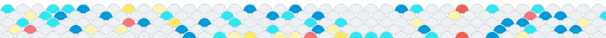
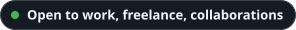
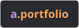
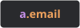
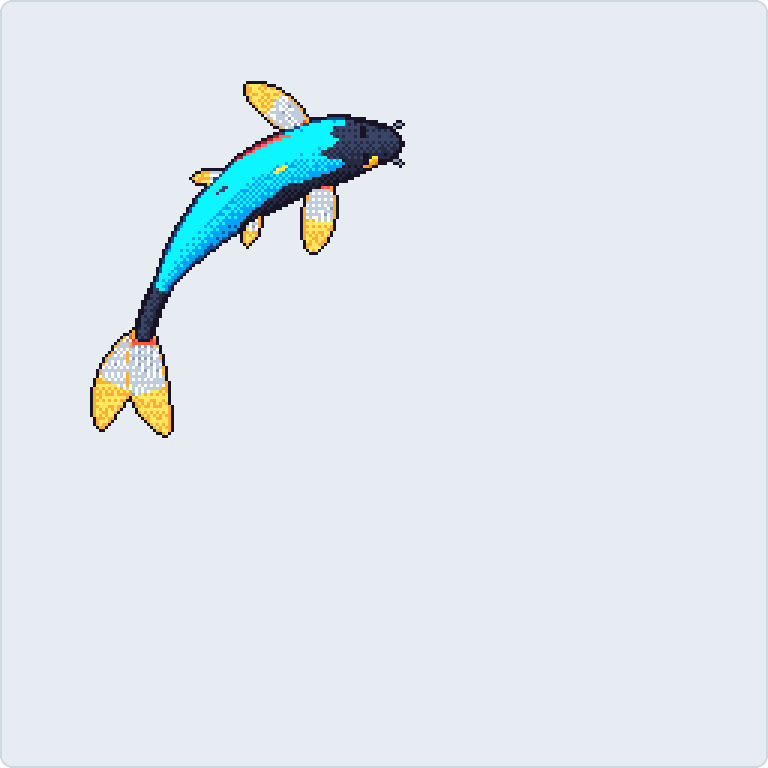
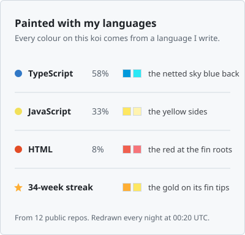

<picture>
  <source media="(prefers-color-scheme: dark)" srcset="https://raw.githubusercontent.com/sergiu-sa/sergiu-sa/koi/scales-dark.svg" />
  
</picture>

# Sergiu Sarbu

**Front-end developer in Oslo.** Creative explorer and occasional chaos mechanic, with a mind wired for problem-solving. I build responsive, user-centred web apps with clean code and deliberate UI.

  
  
  
  

  <picture>
    <source media="(prefers-color-scheme: dark)" srcset="https://raw.githubusercontent.com/sergiu-sa/sergiu-sa/koi/koi-dark.gif" />
    
  </picture>
  <picture>
    <source media="(prefers-color-scheme: dark)" srcset="https://raw.githubusercontent.com/sergiu-sa/sergiu-sa/koi/key-dark.svg" />
    
  </picture>

### Stack

`CSS / Sass` `Git & GitHub` `Tailwind CSS` `Figma` `REST APIs` `AI-assisted workflows` `LLM APIs` `React` `Three.js` `Vitest` `Playwright`
